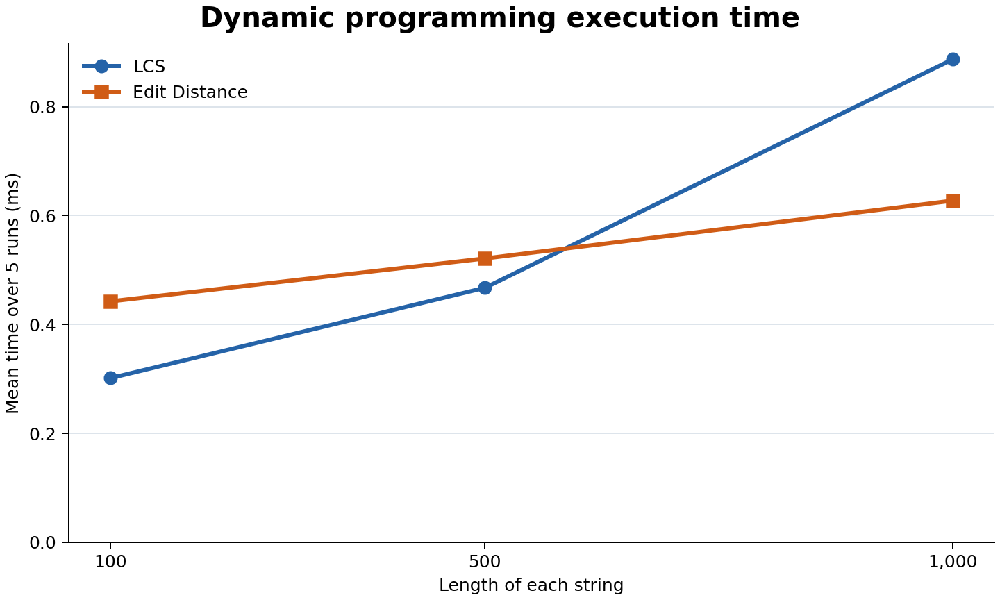
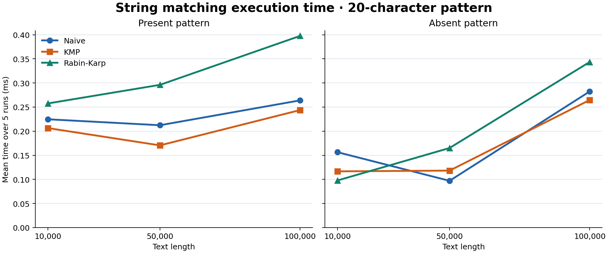

# Assignment 4: Text analysis

This Java project implements LCS, Levenshtein edit distance, Naive search, KMP, Rabin-Karp, and Kasai's algorithm. The benchmarks compare the two dynamic programming routines and the three search routines. Kasai is timed separately.

## How to run

Use JDK 11 or later. Run these commands from the repository root.

```bash
mkdir -p out
javac -d out src/*.java
java -cp out Tests
java -cp out Experiments
```

The benchmark writes [results/timings.csv](results/timings.csv).

## How the algorithms work

**LCS.** Each table entry gives the longest common subsequence length for two prefixes. An empty prefix gives zero. If the final characters match, add one to the diagonal answer. If they differ, a common subsequence must leave out at least one of those final characters, so take the larger answer from above or to the left.

**Edit distance.** The first row and column count the edits needed to insert or delete a whole prefix. Matching final characters carry over the diagonal answer. Otherwise, add one to the smallest of the three neighboring answers for insertion, deletion, and substitution.

**String matching.** Naive tries every possible starting position. KMP uses an LPS table to keep the longest usable part of a partial match when it encounters a mismatch. Rabin-Karp updates the hash as the window moves and checks the actual characters whenever hashes match.

**Kasai.** The input includes a sorted suffix array. Each LCP entry gives the common prefix length of the suffix at that rank and the one immediately before it. The first entry is zero. Moving one position forward in the text lets Kasai reuse the previous prefix length minus one when it is positive. For `banana`, the suffix array `[5, 3, 1, 0, 4, 2]` gives `[0, 1, 3, 0, 0, 2]`.

Strings are non-null. Comparisons are case-sensitive and use Java UTF-16 code units. Match positions start at zero and include overlaps. An empty pattern matches all `n + 1` boundaries.

## Complexity

For dynamic programming, `n` and `m` are the two positive string lengths. For matching, `n` is text length, `m` is pattern length, and `a = n - m + 1`. The matching bounds assume `1 <= m <= n` and exclude space for the returned indices.

| Algorithm | Main work | Best time | Worst time | Extra space |
| --- | --- | --- | --- | --- |
| LCS | Fill all prefix pairs from the diagonal or the maximum of two neighbors | O(nm) | O(nm) | O(nm) |
| Edit Distance | Fill all prefix pairs using up to three possible edits | O(nm) | O(nm) | O(nm) |
| Naive | Check up to m characters at each of a starts | O(a) | O(am) | O(1) |
| KMP | Build LPS in O(m) and scan the text in O(n) | O(n + m) | O(n + m) | O(m) |
| Rabin-Karp | Build hashes in O(m), roll through a windows, and verify hash hits | O(n + m) | O(nm) | O(1) |
| Kasai | Build ranks and reuse the previous prefix length during the scan | O(n) | O(n) | O(n) |

Rabin-Karp approaches linear time when few windows need verification. If many windows have the same hash as the pattern, verification can take O(m) per window. Kasai's bounds apply after the suffix array is ready.

## Tests

The tests cover identical, different, and empty strings. They check insertion, deletion, and substitution separately. All three matchers are checked against the same expected indices, including overlaps, an absent pattern, a pattern longer than the text, and a hash collision. The tests also check a known KMP LPS table and the LCP array for `banana`.

The test run printed:

```text
LCS OK
Edit Distance OK
Naive, KMP, Rabin-Karp OK
Kasai OK
```

## Benchmark setup

The benchmark generates strings from `ABCD` with `Random(42)`. Both DP routines use the same pair at each length (100, 500, and 1,000). The three matchers share each text and pattern. The present pattern is a 20-character substring from the middle of the text. Replacing its last character with `E` guarantees an absent pattern. Kasai runs on texts of length 1,000, 5,000, and 10,000.

Each case has three warm-up calls and five timed calls using `System.nanoTime()`. String generation, suffix sorting, and CSV output happen outside the timed calls. Matching times include preprocessing and counter increments. The KMP character count includes LPS construction. Rabin-Karp counts hash checks separately from character checks.

## Results





Each row reports the mean of five runs. A zero in an unused counter column means the counter does not apply.

| Algorithm | Scenario | Size | Mean (ms) | DP cells | Char checks | Hash checks |
| --- | --- | ---: | ---: | ---: | ---: | ---: |
| LCS | DP | 100 | 0.301691 | 10000 | 0 | 0 |
| Edit Distance | DP | 100 | 0.442600 | 10000 | 0 | 0 |
| LCS | DP | 500 | 0.467450 | 250000 | 0 | 0 |
| Edit Distance | DP | 500 | 0.521300 | 250000 | 0 | 0 |
| LCS | DP | 1000 | 0.886967 | 1000000 | 0 | 0 |
| Edit Distance | DP | 1000 | 0.627484 | 1000000 | 0 | 0 |
| Naive | Present | 10000 | 0.224675 | 0 | 13353 | 0 |
| KMP | Present | 10000 | 0.206425 | 0 | 12471 | 0 |
| Rabin-Karp | Present | 10000 | 0.257500 | 0 | 171 | 9981 |
| Naive | Absent | 10000 | 0.156433 | 0 | 13353 | 0 |
| KMP | Absent | 10000 | 0.116658 | 0 | 12473 | 0 |
| Rabin-Karp | Absent | 10000 | 0.097758 | 0 | 116 | 9981 |
| Naive | Present | 50000 | 0.212334 | 0 | 66551 | 0 |
| KMP | Present | 50000 | 0.170558 | 0 | 61668 | 0 |
| Rabin-Karp | Present | 50000 | 0.296083 | 0 | 662 | 49981 |
| Naive | Absent | 50000 | 0.097067 | 0 | 66551 | 0 |
| KMP | Absent | 50000 | 0.118217 | 0 | 61669 | 0 |
| Rabin-Karp | Absent | 50000 | 0.165092 | 0 | 627 | 49981 |
| Naive | Present | 100000 | 0.263875 | 0 | 133474 | 0 |
| KMP | Present | 100000 | 0.243742 | 0 | 125047 | 0 |
| Rabin-Karp | Present | 100000 | 0.397567 | 0 | 1369 | 99981 |
| Naive | Absent | 100000 | 0.282375 | 0 | 133474 | 0 |
| KMP | Absent | 100000 | 0.264667 | 0 | 125049 | 0 |
| Rabin-Karp | Absent | 100000 | 0.343500 | 0 | 1301 | 99981 |
| Kasai | LCP | 1000 | 0.059608 | 0 | 0 | 0 |
| Kasai | LCP | 5000 | 0.130925 | 0 | 0 | 0 |
| Kasai | LCP | 10000 | 0.039375 | 0 | 0 | 0 |

## Discussion

Going from length 100 to 1,000 raised the DP cell count from 10,000 to 1,000,000. The measured times grew by less than that factor. Allocation and JVM warm-up can affect such short measurements.

At 100,000 characters, KMP had the lowest mean for both the present pattern (0.243742 ms) and the absent pattern (0.264667 ms). At 50,000 characters with an absent pattern, Naive was faster than KMP in this run. Rabin-Karp made fewer character comparisons and also checked a hash at each window.

Kasai took less time at 10,000 characters than at 5,000 in this run. The linear bound describes how its work grows after suffix sorting. The table shows elapsed time for these specific inputs.

## Conclusion

LCS measures how much ordered content two strings share. Edit Distance counts the changes needed to turn one into the other. Both use a full DP table here. For searching, Naive uses constant working space, while KMP uses an LPS table to guarantee a linear scan. Rabin-Karp also uses constant working space, with extra work on hash hits. Kasai builds the LCP array in linear time given a suffix array.